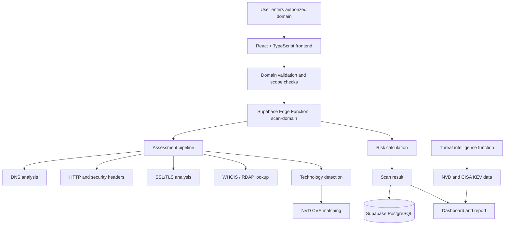

# SecureScope — Web Security Assessment and Vulnerability Risk Analysis

SecureScope is a web-based platform for **non-invasive web security assessment and vulnerability risk analysis**. It helps users assess an authorized public domain, review security-related configuration details, identify potential findings, and understand the overall risk through a consolidated score and report.

> **Authorization notice:** Only scan domains you own or have explicit written permission to assess. Local and private addresses are blocked.

## Screenshots

### Landing page


### Scan overview — low-risk example


### Security headers and cookie analysis


### Scan overview — high-risk example


*The screenshots show example scan results from different assessments. Scores and findings depend on the target domain and the results returned during each scan.*

## Key Features

- **Domain validation:** checks the submitted domain and blocks local/private addresses.
- **Security findings:** presents detected issues with severity and confidence information.
- **Risk overview:** displays an overall score from 0–100 and a risk category.
- **Severity distribution:** summarizes findings by severity.
- **HTTP security headers:** checks the presence and configuration of selected security headers.
- **Cookie security:** displays cookie attributes such as `Secure`, `HttpOnly`, and `SameSite`.
- **SSL/TLS assessment:** presents available certificate and TLS-related information.
- **DNS and WHOIS analysis:** displays DNS records and domain registration-related information.
- **Technology and CVE analysis:** identifies detected technologies/versions and checks for matching known vulnerabilities where data is available.
- **Threat intelligence:** uses public vulnerability and known-exploitation sources to provide additional context.
- **Reports:** provides a place to review assessment results.

## How It Works

1. The user enters a domain they are authorized to assess.
2. SecureScope validates the domain and checks that it is within the permitted scope.
3. The scan pipeline performs the available DNS, HTTP, TLS, WHOIS, technology and vulnerability checks.
4. Findings and matched vulnerability information are collected into the assessment result.
5. The risk calculation combines supported finding, CVSS and known-exploitation signals, with component caps to keep the total score within 0–100.
6. The dashboard presents the score, severity distribution, module status and detailed analysis.

## Risk Score

The dashboard displays an overall risk score on a **0–100** scale. The score is based on the assessment data available for that scan, including:

- Security findings (severity and confidence)
- The highest CVSS score among matched CVEs
- Known exploitation information from CISA KEV

Each component is capped so the combined score stays within the 0–100 range. The dashboard also displays a risk category such as **Low, Medium, High or Critical**. The exact score and category depend on the scan results.

## Technology Stack

The project uses the following technologies and services:

| Area | Technology |
|---|---|
| Frontend | React, TypeScript, Vite |
| Styling and UI | Tailwind CSS, Framer Motion |
| Backend functions | Supabase Edge Functions (Deno + TypeScript) |
| Database | Supabase / PostgreSQL |
| DNS lookup | Cloudflare DNS-over-HTTPS |
| Certificate information | crt.sh |
| Vulnerability information | NVD CVE API |
| Known exploited vulnerabilities | CISA KEV catalog |
| Domain registration information | WHOIS / RDAP |

## Architecture



## Project Structure

The project contains a React frontend and Supabase backend functions. The deployed `scan-domain` function is organized into assessment modules such as validation, pipeline, DNS, HTTP, TLS, WHOIS, technology detection, CVE matching, findings and risk calculation.

A simplified view:

```text
SecureScope/
├── frontend source files
│   ├── React pages and components
│   ├── Supabase client configuration
│   └── styles and UI assets
└── supabase/
    └── functions/
        ├── scan-domain/
        │   ├── index.ts
        │   ├── validate.ts
        │   ├── pipeline.ts
        │   ├── models.ts
        │   ├── risk.ts
        │   ├── findings.ts
        │   ├── cve.ts
        │   ├── technology.ts
        │   ├── whois.ts
        │   ├── tls.ts
        │   ├── http.ts
        │   └── dns.ts
        └── threat-intel/
```

*Update this tree if your repository uses different folder names or additional files.*

## Getting Started

### Prerequisites

- Node.js and npm
- A Supabase project
- Supabase project URL and anon key
- The required Supabase Edge Functions deployed and configured

### 1. Clone the repository

```bash
git clone https://github.com/<your-username>/<your-repository>.git
cd <your-repository>
```

### 2. Install frontend dependencies

```bash
npm install
```

### 3. Configure environment variables

Create a `.env` file in the frontend project root and add your Supabase project values:

```env
VITE_SUPABASE_URL=https://<your-project-ref>.supabase.co
VITE_SUPABASE_ANON_KEY=<your-supabase-anon-key>
```

If your local setup also uses a separate FastAPI scanning service, configure `VITE_SCAN_API_URL` according to that backend's address. Do not add credentials, service-role keys, or other secrets to GitHub.

### 4. Run the development server

```bash
npm run dev
```

Open the local URL printed by Vite in your terminal.

## Supabase Setup

The application uses Supabase for backend functionality and scan-result storage. Configure the database table and deploy the Edge Functions required by your version of the project.

The scan history table stores assessment information such as the target domain, status, risk score, risk category, result payload, scan duration and creation time.

Deploy/configure the functions using the Supabase CLI and your project's setup:

```bash
supabase login
supabase link --project-ref <your-project-ref>
supabase functions deploy scan-domain
supabase functions deploy threat-intel
```

Make sure any required function secrets and database policies are configured before using the application. Never publish secret values in this README or commit your `.env` file.

## Responsible Use

SecureScope is intended for **authorized, non-invasive security assessment**. Only assess domains that you own or have explicit written permission to test. Do not use the platform to scan systems without authorization. Results are informational and should be reviewed by a qualified security professional before making security decisions.

## Limitations

- Results depend on publicly observable responses and the availability of external data sources.
- Technology/version detection and CVE matching may not identify every component or vulnerability.
- A CVE match is an indication for further investigation, not proof that a target is exploitable.
- A low score does not guarantee that a website is secure.
- External APIs and DNS/certificate services may change availability or response formats.

## Author

**Developed by Keya Saha**


